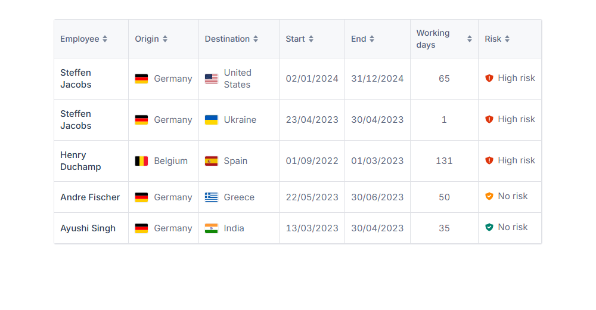

# WorkFlex – Workation Platform

Full-stack coding challenge: an API that lists workations imported from a CSV, and
an Angular UI that renders them as a sortable table.



## Repository layout

| Folder          | Stack                                   | Description                          |
| --------------- | --------------------------------------- | ------------------------------------ |
| `Workation_BE/` | Java 26 · Spring Boot 4.1 · Gradle · H2   | REST API + CSV import on startup     |
| `Workation_FE/` | Angular 22 · Angular Material (signals)  | Sortable table UI                    |

## Run with Docker (recommended)

The whole stack runs with one command — no local JDK/Node needed, only Docker:

```bash
docker compose up --build
```

This builds and starts two containers:

| Service    | Container port | Host port | URL                           |
| ---------- | -------------- | --------- | ----------------------------- |
| `backend`  | 8080           | 8080      | <http://localhost:8080>       |
| `frontend` | 80 (nginx)     | 8081      | **<http://localhost:8081>**   |

Open **<http://localhost:8081>**. The frontend (nginx) serves the built Angular app
and proxies `/workflex/**` to the backend container, so there are no CORS issues.
The frontend waits for the backend's healthcheck before starting. Stop with
`docker compose down`.

Each app is also independently containerised — see `Workation_BE/Dockerfile`
(multi-stage Gradle build → slim JRE) and `Workation_FE/Dockerfile`
(Angular build → nginx).

## Run locally (without Docker)

### Prerequisites

- JDK 26 (the backend targets `java.version` 26)
- Node.js 20+ and npm

**Backend** (port 8080):

```bash
cd Workation_BE
./gradlew bootRun
```

On startup the app imports `src/main/resources/data/workations.csv` into an in-memory
H2 database (skipped if the table is already populated).

**Frontend** (port 4200):

```bash
cd Workation_FE
npm install
npm start
```

`npm start` runs `ng serve` with `proxy.conf.json`, which forwards `/workflex/**`
to `http://localhost:8080` — so run the backend first, then open
<http://localhost:4200>.

## API

`GET /workflex/workation`

| Query param | Values                                                        | Default    |
| ----------- | ------------------------------------------------------------- | ---------- |
| `sortBy`    | `employee`, `origin`, `destination`, `startDate`, `endDate`, `workingDays`, `risk` | `employee` |
| `direction` | `asc`, `desc`                                                 | `asc`      |

Responses use a consistent envelope: `{ "status", "message", "data" }`. Unknown
sort fields return `400` (the backend whitelists sortable fields).

## Architecture notes

- **Layering (BE):** `web` → `service` → `repository`, with the CSV import path
  (`csv` package: parser → record → mapper → entity) kept separate from the query
  path (`dto` mapper: entity → response). Constants and messages are centralised.
- **Table:** built with Angular Material (`mat-table` + `matSort`). The presentational
  cells (`LocationCellComponent`, `RiskBadgeComponent`) are reused inside the Material
  cells, and the components are `OnPush`.
- **Reactive data loading.** The table uses a signal-based `rxResource` — the sort
  field/direction are signals, and the resource re-fetches automatically when they
  change (no `ngOnInit`, no manual subscription/teardown). Sorting is still delegated
  to the backend, so the server's tested sort logic is the single source of truth
  (Material provides the header UI and `aria-sort`, not the ordering).
- **Risk levels:** `NO` and `LOW` both display as **"No risk"** but with different
  shield icons (green for `NO`, amber for `LOW`); `HIGH` displays as **"High risk"**
  (red). The shields are SVGs in `Workation_FE/public/icons/risk-<level>.svg`. The
  distinction is preserved end-to-end from the CSV.
- **Flags:** country names are resolved to ISO codes with `i18n-iso-countries`
  (any country, not a hardcoded list) and rendered with the `flag-icons` SVG
  package (cross-platform — unlike flag emojis, which don't render on Windows).
- **Dates:** stored/transported as ISO (`yyyy-MM-dd`), formatted for display as
  `dd/MM/yyyy` in the UI.

## Testing

```bash
cd Workation_BE && ./gradlew test  # 20 tests: unit, @WebMvcTest slice, integration
cd Workation_FE && npm test        # 21 tests: service, pipes, components (Vitest)
```
